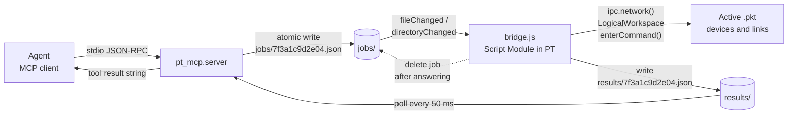
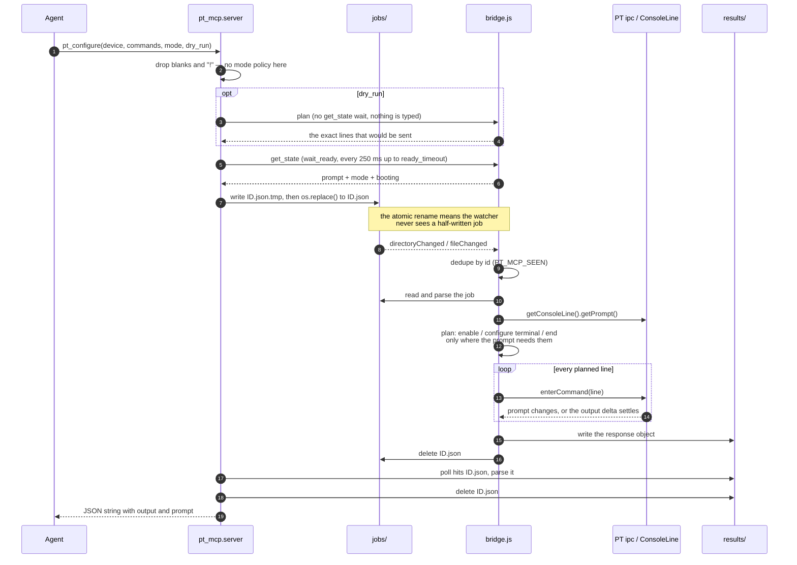
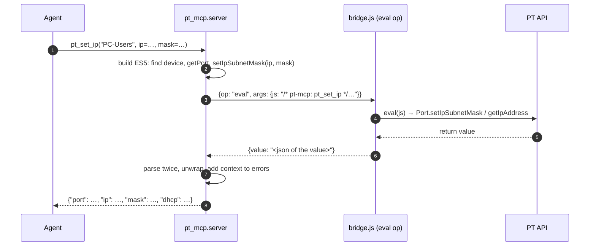

# Architecture

How `packet-tracer-mcp` lets an AI agent drive a live Cisco Packet Tracer 9.x
topology, and why the design looks the way it does.

The short version: the MCP server and Packet Tracer share **one directory of JSON
files**. There is no socket, no plugin build, and no Cisco code in this
repository. Everything below elaborates that one sentence.

| Document | Covers |
|---|---|
| **This file** | why each piece exists, how they fit, what breaks |
| [setup.md](setup.md) | the one-time Script Module clicks in the PT GUI |
| [protocol.md](protocol.md) | the exact wire format, op list, cleanup rules |
| [cli-semantics.md](cli-semantics.md) | prompt/mode rules, per-line waiting, readiness, `dry_run` |
| [../README.md](../README.md) | usage, tools, troubleshooting |

## Purpose

The goal is narrow and concrete: **an agent configures a running Packet Tracer
topology without clicking the GUI.** That covers the whole workflow a lab
exercise needs —

- add and remove devices (`pt_add_device`, `pt_remove_device`),
- cable them (`pt_link`, `pt_autolink`),
- push IOS CLI into a device's console (`pt_configure`),
- read the result back (`pt_show`),
- power-cycle (`pt_power`) and snapshot the file (`pt_save`),
- and, when the tool surface runs out, run a line of JS in PT itself (`pt_raw`).

Packet Tracer is the source of truth and the thing that does the work: it owns
the topology, the device models, and the simulated IOS. This project is only the
**transport and the tool surface** in front of it. Nothing here reimplements a
router, parses configs into a model, or renders a diagram — the agent asks PT to
change PT, then asks it what happened.

The agent speaks MCP over stdio; the PT side is a Script Module running the ES5
file [`bridge/bridge.js`](../bridge/bridge.js). Both sides are ordinary
processes with one thing in common: a directory.

## Why file-drop

### What the Script Engine cannot do

Packet Tracer's Script Module engine is **QtScript — ES5 only** (`var` and
`function`; no `let`, arrows, template literals, classes, or `import`). Two
consequences dominate the design:

1. **No wall-clock timers.** There is no usable `setInterval`/`setTimeout` an
   outside caller can rely on to poll a queue, and no event loop that keeps
   running between evaluations. Anything that must "stay awake" has to be
   triggered by PT itself.
2. **No networking.** There is no socket API to open, and no way to load one.
   The engine cannot listen on a port, cannot dial out, and cannot speak HTTP or
   JSON-RPC.

So an outside server cannot *call into* PT, and PT cannot *call out to* the
server. Any design that assumes either one is dead on arrival.

### What it can do

`SystemFileManager` (`ipc.systemFileManager()`) is the one reliable host bridge,
and it is generous: read a file, write a file, list a directory, create/delete
directories and files, and — critically — **register a file watcher**
(`getFileWatcher()` → `registerEvent("fileChanged"|"directoryChanged")` +
`addPath()`). That is enough to build a durable request/response queue:

- the MCP server is a normal OS process: it writes a job file and polls for the
  answer;
- the bridge lives inside PT: it is woken by a filesystem event, does the work
  through the `ipc.*` API, writes a result file, and deletes the job.

No listener, no handshake, no port to firewall, no token to distribute.

### Alternatives considered and rejected

| Approach | Why not |
|---|---|
| **TCP/WebSocket listener inside PT** | The engine has no socket API at all. Nothing to bind. |
| **Embedded webview / Qt bridge hack** | Requires patching or a custom PT build; not portable across installs and unsupported. |
| **ExApp / PTMP (PT's own scripting host)** | Heavyweight external-plugin toolchain, version-pinned, and not what a stdlib-only setup should depend on. Also unnecessary: the file system already is a channel. |
| **Screen-scraping / GUI automation** | Exactly the thing the project exists to avoid: brittle, GUI-bound, and it fights PT for input focus. |
| **A second daemon PT talks to** | PT still could not reach it — no networking. The file system is the daemon. |

The cost of the file-drop choice is honest and small: **latency is one poll
interval (50 ms) rather than microseconds**, and every call is serialized
through one directory. Both are invisible next to the seconds a simulated device
takes to boot or apply a config line. The benefit is that the whole protocol is
inspectable with `ls` and `cat`, survives a PT restart without reconfiguration,
and needs no credential — only the PT privileges you granted the module (see
[Security model](#security-model)).

## Components

| Layer | Lives in | Responsibility |
|---|---|---|
| **MCP client (agent)** | opencode / Claude / any stdio client | Turns user intent into tool calls; never sees a file path. |
| **`pt_mcp.server`** | `src/pt_mcp/server.py` | Twenty-two MCP tools over stdio; splits input, waits for a usable prompt, generates the host/topology JS that rides the `eval` op, renders every failure as `{"ok": false, "error": …}`. |
| **Transport** | `src/pt_mcp/protocol.py`, `src/pt_mcp/config.py` | Atomic job write, 50 ms polling, stale-id detection, cleanup on success and on timeout. |
| **Mailbox** | `$PT_MCP_HOME/{jobs,results,saved}` | The only shared state. Defaults to `~/.local/share/pt-mcp`. |
| **`bridge/bridge.js`** | inside Packet Tracer (Script Module `com.psampir.ptmcp`) | File watcher + job dedupe + op dispatch; the only code that touches the PT API. |
| **PT API** | `ipc.network()`, `ipc.appWindow().getActiveWorkspace().getLogicalWorkspace()`, `CiscoDevice`/`ConsoleLine` | The actual capability: devices, links, console input, save, version. |
| **The `.pkt`** | Packet Tracer's active window | The lab being configured. The bridge only ever sees the active one. |

### Topology



Read it as two independent loops that meet in the middle: the server owns
`jobs/` on the way in and `results/` on the way out; the bridge owns the reverse.
Neither side knows how the other is implemented — only the file names and the
JSON shape.

## Call flow: one `pt_configure`

A config push is the richest call, because it is the only one that takes a list
and has to get console *mode* right. Everything else is the same path with fewer
steps.



Notes on the middle of that sequence, because this is where the design has real
opinions:

**Atomicity on the way in.** The server writes `<id>.json.tmp` and then
`os.replace()`s it into place, which is atomic within one POSIX filesystem. A
watcher therefore only ever observes a complete JSON document, and the bridge
explicitly ignores `.tmp` files when scanning.

**Dedupe on the bridge side.** `PT_MCP_SEEN` remembers ids already handled in
this PT session, so a duplicate watcher event (these fire in bursts) cannot run a
config twice. The bridge deletes the job **after** writing the result, so a crash
between the two leaves a job that a later rescan will retry — the safe direction.

**Mode, and why the sequence is computed on the PT side.** Console state is
modal: `enable` gets you `#`, `configure terminal` gets you `(config)#`, an
interface block gets you `(config-if)#`. An agent that sends only the interesting
lines ("hostname R1", "no shutdown") would otherwise type them into whatever mode
the previous call left behind — but the server cannot know that mode, and cannot
know whether the target is a PC's `C:\>` at all.

So `normalize_commands()` only splits and strips, and the bridge asks the device
for its prompt (`getPrompt()`) and decides:

| Prompt | `auto` does |
|---|---|
| `C:\>` (shell) | sends the lines verbatim — **zero** insertions on a PC |
| `Switch>` | prepends `enable`, then decides again |
| `Switch#` | `configure terminal` + body + `end`, unless the first line is an exec verb (`show`, `ping`, …) |
| `S1(config)#` | body + `end` |

`mode="raw"` disables all of it, `mode="exec"` never enters config, `mode="config"`
forces the wrappers, and `keep_session=True` drops the trailing `end`. The
requested mode and the resolved one are both returned (`mode`, `effective_mode`),
and `dry_run=True` returns the plan without typing anything — the cheapest way to
catch a mode bug before it costs a console. Full rules:
[cli-semantics.md](cli-semantics.md).

Lines go through the device's `ConsoleLine.enterCommand(cmd)` (preferred — it
exposes `getOutput()` and `getPrompt()`), falling back to
`CiscoDevice.enterCommand(cmd, mode)` with an **empty** mode string, meaning
"keep the line's current mode". Each line is sent **alone**, then the bridge
waits for the prompt to change or for the output buffer to stay unchanged for
120 ms, and reports that line's delta, `ok` flag and prompt (PTM-06). A line that
is rejected or never settles is reported with its 1-based index instead of being
skipped silently.

**Readiness is the server's job.** The bridge must not spin for tens of seconds
(no timers), so the *server* polls `get_state` every 250 ms with a real
`time.sleep` until a freshly added router leaves
`--- System Configuration Dialog ---` and shows a prompt (PTM-01).

**Atomicity on the way out — best effort.** `SystemFileManager` has no `rename`,
so the bridge writes the result in one call and the server tolerates a partial
read by retrying the JSON parse every 50 ms instead of failing.

### Host and topology tools: server-side, over `eval`

The console tools delegate to bridge ops, but the API tools do not need one. Each
of `pt_get_config`, `pt_set_ip`, `pt_set_ipv6`, `pt_dns_record`, `pt_dns_list`,
`pt_http_page`, `pt_pc_command`, `pt_ping`, `pt_list_links` and `pt_list_ports`
generates a small ES5 snippet, tags it with `/* pt-mcp: <tool> */`, and sends it
through the **existing** `eval` op:



This is what keeps `bridge.js` stable: a new capability on the API costs a Python
change and no Script Module re-paste. The trade-off is that the JS runs inside the
engine with the module's privileges, exactly like `pt_raw` — read the
[security model](#security-model).

## Wire protocol (summary)

Full detail — every op, every argument, every result shape — is in
[protocol.md](protocol.md). The contract is two objects:

```json
{"id": "7f3a1c9d2e04", "op": "configure", "args": {"device": "R1", "lines": ["enable"]}}
```

```json
{"id": "7f3a1c9d2e04", "ok": true,  "result": {"output": "…", "prompt": "R1#"} }
{"id": "7f3a1c9d2e04", "ok": false, "error": "device not found: R1"}
```

- `id` — 12 hex characters (`uuid4().hex[:12]`), also the file stem on both sides.
- `op` — `ping`, `list_devices`, `add_device`, `remove_device`, `link`,
  `autolink`, `get_state`, `plan`, `configure`, `exec` (and `show` as its alias),
  `power`, `skip_boot`, `save`, `eval`.
- Exactly one of `result` / `error`. The server turns `error` into
  `PTBridgeError`, and the tool renders it as
  `{"ok": false, "error": "Packet Tracer bridge error for op '…': …"}`.

## Execution semantics

**The active file only.** The bridge reaches PT through
`ipc.appWindow().getActiveWorkspace()`, so it configures whichever `.pkt` is in
front — never a lab open in another window, never a file on disk it was not given.
This is a deliberate safety property (no accidental cross-lab edits) and the
first thing to check when a device "does not exist".

**Jobs are processed serially.** `processPending()` holds a re-entrancy guard
(`PT_MCP_BUSY` / `PT_MCP_AGAIN`): watcher events that arrive mid-run coalesce into
one more pass rather than running concurrently. One console, one command stream —
no interleaved configs, no race for a device's console line.

**One call is one round trip, and it is bounded.** `PT_MCP_TIMEOUT` (default
120 s) caps every job. On timeout the server **deletes its own job file** before
raising, so a bridge that wakes up later cannot execute a command nobody is
waiting for — a half-applied config the agent never saw is worse than no config.
The raised error carries a PT-side checklist instead of a bare "timeout".

**A dropped watcher event is recoverable.** Some setups (AppImage/FUSE mounts,
network homes, PT in another mount namespace) deliver no filesystem events at
all. Jobs then sit until timeout, but nothing is lost: clicking **Run File**
re-evaluates `bridge.js`, which re-registers the watcher and immediately calls
`processPending()`; `ptmcp_rescan()` does the same from the PT console; Stop →
Start restarts the module. Because the job file is still there, the work
completes on the rescan. See [setup.md §5](setup.md#5-forcing-a-rescan-watcher-not-firing).

**Stale results are harmless.** A result file whose `id` does not match the
current request is left untouched and polling continues, so a leftover from an
earlier timeout cannot be mistaken for this call's answer.

**Failures never raise into the agent.** `run_op()` catches `PTBridgeError` and
anything unexpected and returns `{"ok": false, "error": …}` as a JSON string, so
an LLM client gets text it can act on rather than a traceback in a tool call.

## Security model

The trust boundary is PT's own sandbox, not this project's code.

- **No networking, nothing exfiltrated.** Neither side opens a socket. The only
  data that moves is what you can see in `jobs/` and `results/` on your own disk.
  There is no account, no telemetry, no remote endpoint.
- **Privileges are declared in PT** under *Security Privileges* and are the real
  access control (see [setup.md §2](setup.md#security-privileges-tab)):

  | Privilege | Grants the bridge |
  |---|---|
  | **Application** | run at all, read the PT version, write PT log lines |
  | **File Operations** | read/write/delete job and result files, save `.pkt`s |
  | **Get Network Info** | enumerate devices and links |
  | **Change Network Info** | add/remove devices, create links, power, send CLI |
  | **Miscellaneous UI** *(optional)* | `writeToPT()` log output only |

  Drop *Change Network Info* and the bridge can no longer mutate the topology:
  `pt_status` and `pt_list_devices` keep working, while add/link/power/configure
  fail with an access-denied error. That is a supported way to run it — though
  whether `pt_show` still answers depends on the build, since issuing a command
  through the console line can itself be gated.
- **`pt_raw` is arbitrary JS in the PT engine.** It is `eval()` of a string you
  (or your agent) pass, with the global `ipc` object in scope — i.e. anything the
  module's privileges allow, including file access inside PT's sandbox. It exists
  because PT's API is larger than eleven tools and a new op otherwise means
  editing `bridge.js` and re-pasting it by hand. It is documented as an escape
  hatch, not a normal step: if you would not hand that string to PT yourself, do
  not let an agent send it. Read-only or untrusted setups should not expose this
  tool to the client at all.
- **No secrets in the channel.** Nothing here needs credentials, and the job
  files carry only device names, coordinates and CLI lines. MIT-licensed code
  only; no Cisco binaries or model files are vendored ([THIRD_PARTY.md](../THIRD_PARTY.md)).

## Failure modes

Every entry is reachable from the outside, and the first four are the ones that
look alike: the call times out with the same checklist. Work down the list —
it is ordered by how often each one is the answer.

| Symptom | Cause | Fix |
|---|---|---|
| Timeout; checklist in the error | **PT closed** or crashed | Start Packet Tracer; the module starts with it (*Startup: On Startup*). |
| Timeout, `pt_status` included | **No `.pkt` open/active** | Open the lab. A device in another window is invisible to the bridge. |
| Timeout, but `jobs/` fills up | **Script Module stopped** | *Extensions → Scripting → Configure PT Script Modules…* → `com.psampir.ptmcp` → **Start** (Stop → Start after editing `bridge.js`). |
| Timeout, and job files are never consumed | **Watcher silent** (FUSE/AppImage/network home) | Click **Run File** to force a rescan, call `ptmcp_rescan()`, or restart the module. Also verify the `PT_MCP_HOME` constant in `bridge.js` matches the server's `$PT_MCP_HOME`. |
| `access denied` / privilege error in PT's log | **Privilege missing** | Enable *Application* + *File Operations* + *Get*/*Change Network Info* on the module, then Stop → Start. |
| Error that the base dir does not exist | Bridge **never ran** | Start the module once (it creates `jobs/`, `results/`, `saved/`), or `mkdir -p` them. |
| Commands succeed but `output` is empty or half a banner | **Device still booting** | The server already waits up to `ready_timeout` (45 s); raise it, use `pt_power(..., ready=True)`, or `skip_boot` for scripted setups. |
| `createLink` fails or the link is missing | **Wrong port name** — names are case-sensitive and model-specific | `pt_show` a `show ip interface brief`, or use `pt_autolink` and let PT choose compatible ports. |
| Serial link is up but the interface stays `down` / protocol down | **Serial clock rate missing on the DCE end** | Configure `clock rate 64000` (and `no shutdown`) on the DCE side; `show controllers serial 0/0/0` tells you which end is DCE. |
| `device not found: X` | Wrong name, or the device is in a non-active `.pkt` | `pt_list_devices` on the active file; bring the right lab to the front. |
| A call times out, then the config shows up minutes later | Should not happen — the server deletes a timed-out job | If it does, `bridge.js` in PT is an older copy: re-paste it and Stop → Start. |

## Extending it

Two routes, depending on what the capability needs:

**A server-side helper** (preferred for the PT API: hosts, ports, DNS, HTTP,
topology) is one new function in `src/pt_mcp/server.py` that builds its ES5 with
`string.Template`, calls `_eval(js, device, op)`, and is wrapped with `_tool(...)`
for JSON-safe errors. No bridge change, no re-paste. Add the tool to the README
table and a test that asserts both the generated JS and the unwrapped value.

**A new bridge op** is needed only when the console or the workspace itself must
change. That means changing exactly three places, in this order:

1. `dispatch()` in [`bridge/bridge.js`](../bridge/bridge.js) — the PT-side
   implementation, ES5 only;
2. a tool in [`src/pt_mcp/server.py`](../src/pt_mcp/server.py) that calls
   `run_op("<op>", args)`;
3. a row in the op table of [protocol.md](protocol.md), plus a
   `tests/fake_bridge.py` handler so the suite still runs offline.

The transport does not change: any op is one `{"id","op","args"}` in and one
`{"id","ok","result"|"error"}` out. `bridge.js` is copied into PT by hand, so a
change there is a stop/start of the Script Module — which is why the API surface
(hosts, ports, DNS, HTTP, topology) is reached through `eval` instead, and why
`pt_raw` still exists as the last resort.
